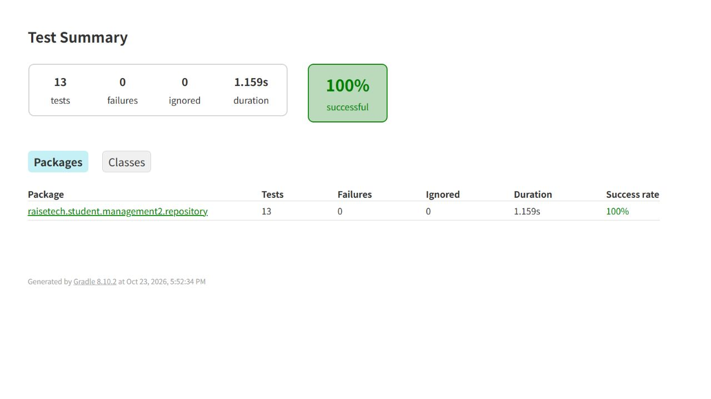

# StudentRepositoryテスト

## 概要

`StudentRepository`のMyBatisマッピングとSQLが正しく動作することを確認するRepositoryテストです。
本番のMySQLには接続せず、テスト実行時だけH2インメモリDBを使用します。

## テスト構成

| ファイル | 役割 |
| --- | --- |
| `StudentRepositoryTest.java` | Repositoryテスト本体 |
| `src/test/resources/repository-schema.sql` | H2用のテーブル定義 |
| `src/test/resources/repository-data.sql` | 受講生10件・コース7件の初期データ |
| `build.gradle` | MyBatisテストとH2の依存関係 |
| `.github/workflows/repository-tests.yml` | GitHub ActionsでRepositoryテストを実行 |

各テストの前に`@Sql`でテーブルとデータを再作成します。そのため、登録・更新・論理削除を行うテストが、別のテスト結果へ影響しません。

## 正常系テスト

| No. | テスト内容 | 確認すること |
| --- | --- | --- |
| 1 | 受講生一覧検索 | 初期データ10件が取得され、各項目が正しくマッピングされること |
| 2 | 受講生の単一検索 | 存在するIDを指定すると、対象受講生のID・氏名・メールアドレスが取得できること |
| 3 | 受講生登録 | 新しい受講生を登録でき、IDが自動採番され、登録内容を再検索できること |
| 4 | コース一覧検索 | 初期データ7件がすべて取得できること |
| 5 | 受講生別コース検索 | 指定した受講生IDに紐づくコースだけが取得できること |
| 6 | コース登録 | 新しいコースを登録でき、IDが自動採番され、登録内容を再検索できること |
| 7 | 受講生情報更新 | 氏名とメールアドレスの更新内容が再検索結果へ反映されること |
| 8 | 論理削除 | 物理削除せず、`isDeleted=true`へ更新されること |

## 該当なし・異常系テスト

| No. | テスト内容 | 期待結果 |
| --- | --- | --- |
| 1 | 存在しない受講生IDを検索 | 例外ではなく`null`が返ること |
| 2 | 存在しない受講生IDのコースを検索 | 空リストが返ること |
| 3 | 名前が`null`の受講生を登録 | `DataIntegrityViolationException`が発生すること |
| 4 | コース名が`null`のコースを登録 | `DataIntegrityViolationException`が発生すること |
| 5 | 存在しない受講生IDへコースを登録 | 外部キー制約により`DataIntegrityViolationException`が発生すること |

## 実行方法

Windows:

```powershell
.\gradlew.bat test --tests raisetech.student.management2.repository.StudentRepositoryTest
```

macOS / Linux:

```bash
./gradlew test --tests raisetech.student.management2.repository.StudentRepositoryTest
```

実行後のHTMLレポートは`build/reports/tests/test/index.html`へ出力されます。

## 動作確認

- テスト数: 13件
- 失敗: 0件
- スキップ: 0件
- 成功率: **100%**
- GitHub Actions: [Repository tests 実行結果](https://github.com/Tempest9174/Spring_Boot_Study_38/actions/runs/40001888314)



## 削除の扱い

このアプリケーションは受講生レコードを物理的に削除しません。`Student.isDeleted`を`true`に更新する論理削除をテストしています。

